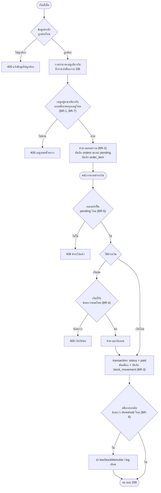

# wk09 – Process Design และ Coding Sprint 2 (กลุ่ม 13)

---

## . Process Design

### 2.1 Business Rule

| #    | Business Rule                                                                                                                               | ที่มา                            |
| ---- | ------------------------------------------------------------------------------------------------------------------------------------------- | -------------------------------- |
| BR-1 | จำนวนที่สั่ง (รวมทุกบรรทัดของเมนูเดียวกัน) มากกว่าสต็อกคงเหลือ → ปฏิเสธการสั่ง                                                              | wk04 UC 3.1 Exception 2a         |
| BR-2 | ราคาต่อหน่วยดึงจาก `menu_item.price` ใน DB แล้วเก็บเป็น snapshot ใน `order_item.unit_price` ห้ามรับราคาจาก client ยอดรวมคำนวณสดไม่เก็บใน DB | FR-02, wk06, wk07 (3NF)          |
| BR-3 | ตัดสต็อกเมื่อ "ชำระเงินสำเร็จ" เท่านั้น ไม่ตัดตอนสั่ง ถ้ายังไม่ชำระสต็อกต้องไม่ลด                                                           | FR-06, wk04 UC 3.3 / US-05       |
| BR-4 | จ่ายเงินสดต้องรับเงินไม่น้อยกว่ายอดรวม ระบบคำนวณเงินทอนให้ เงินโอนไม่คิดเงินทอน                                                             | FR-03, wk04 UC 3.2               |
| BR-5 | ออเดอร์ชำระได้ครั้งเดียว (pending → paid) กันตัดสต็อกซ้ำ                                                                                    | wk04 UC 3.2 Postcondition        |
| BR-6 | หลังตัดสต็อก ถ้าคงเหลือน้อยกว่า `low_stock_threshold` (ค่าเริ่มต้น 10) ให้แจ้งเตือนสต็อกใกล้หมด                                             | wk04 US-05b, wk07 schema         |
| BR-7 | เมนูต้องอยู่สาขาเดียวกับออเดอร์ และการแก้/ลบเมนูต้องระบุ `branchId` คู่กับ `menu_id` เสมอ                                                   | wk07 ER (menu_item มี branch_id) |

### 2.2 Flowchart

---

## 3. ตรวจความสอดคล้อง Diagram กับโค้ด

ไฟล์: `src/controllers/orderController.js`, `src/models/menuItemModel.js`, `orderModel.js`, `orderItemModel.js`, `stockMovementModel.js`

| โค้ด                                                                                                | องค์ประกอบใน Diagram                                        |
| --------------------------------------------------------------------------------------------------- | ----------------------------------------------------------- |
| `createOrder`: เช็ค `branchId/employeeId`, `PAYMENT_METHODS`, `items` ว่าง, `hasInvalidShape` → 400 | 1.1 alt ชั้นนอก "ข้อมูลนำเข้าไม่ถูกต้อง"                    |
| `sumQuantityByMenuId(items)`                                                                        | 1.1 `C->>C: sumQuantityByMenuId`                            |
| `menuItemModel.findByIds`                                                                           | 1.1 `C->>MM` และ `MM->>DB: SELECT menu_item`                |
| `for (... of quantityByMenuId)` เช็คไม่พบ / ต่างสาขา / `stock_quantity < totalQuantity` → 400       | 1.1 alt ชั้นใน "ไม่พบเมนู / ต่างสาขา / สต็อกไม่พอ"          |
| `new Order` + `addItem` + `calculateTotal()`                                                        | 1.1 `C->>C: new Order / addItem / calculateTotal`           |
| `orderModel.create`                                                                                 | 1.1 `C->>OM` และ `OM->>DB: INSERT INTO orders`              |
| `for (const orderItem of order.items)` → `orderItemModel.addItem`                                   | 1.1 loop + `INSERT INTO order_item`                         |
| `res.status(201).json({...})`                                                                       | 1.1 `C-->>UI: 201 Created`                                  |
| `payOrder`: `orderModel.findById` → 404 / `status !== "pending"` → 409                              | 1.2 alt แรก                                                 |
| `orderItemModel.findByOrderId` + `reduce` รวมยอด                                                    | 1.2 `findByOrderId` และ `totalAmount = sum`                 |
| `cashReceived < totalAmount` → 400                                                                  | 1.2 alt ชั้นใน "เงินสดไม่พอ"                                |
| `deductMap` → `deductions`                                                                          | 1.2 `C->>C: รวมจำนวนต่อเมนู`                                |
| `orderModel.markPaid` (`beginTransaction` ... `commit`)                                             | 1.2 `BEGIN` ... `COMMIT`                                    |
| `UPDATE orders SET status='paid' WHERE ... AND status='pending'`                                    | 1.2 `UPDATE orders`                                         |
| `for (... of deductions)` → `decreaseStock` + `stockMovementModel.add`                              | 1.2 loop: `UPDATE menu_item` + `INSERT INTO stock_movement` |
| `menuItemModel.findByIds` + `filter(stock_quantity < low_stock_threshold)`                          | 1.2 `findByIds` และ `lowStockMenuIds`                       |
| `res.json({status:"paid", totalAmount, change, lowStockMenuIds})`                                   | 1.2 `C-->>UI: 200 OK`                                       |

Business logic (ตัดสินใจสต็อกพอไหม, คำนวณ `lowStockMenuIds`) อยู่ใน Controller ส่วน Model ทำหน้าที่เข้าถึงข้อมูลอย่างเดียว ยกเว้น `markPaid` ที่ Model เป็นเจ้าของ transaction เพราะต้องให้หลายตารางสำเร็จหรือล้มพร้อมกัน

---

## 4. จุดที่ต่างจากงานสัปดาห์ก่อน (Diagram-Code Drift)

| จุดที่ต่าง                                                                                     | ต้นทาง                                   | เหตุผล                                                                                                                                                        | สถานะ diagram ต้นทาง                                            |
| ---------------------------------------------------------------------------------------------- | ---------------------------------------- | ------------------------------------------------------------------------------------------------------------------------------------------------------------- | --------------------------------------------------------------- |
| ตัดสต็อกตอน "ชำระเงินสำเร็จ" ไม่ใช่ตอนสั่ง (ตัวอย่างในเอกสาร wk09 ตัดตอนสั่ง)                  | wk03 FR-06, wk04 UC 3.3 / US-05          | ข้อกำหนดที่ตกลงไว้ระบุว่าตัดหลังขายสำเร็จ และ US-05 ระบุว่าถ้าไม่จ่ายต้องไม่ตัดสต็อก จึงปรับ diagram ให้ตรงกับ requirement ไม่ปรับ requirement ตามตัวอย่าง    | ไม่ต้องแก้ wk03/wk04                                            |
| เพิ่ม `PATCH /api/orders/:id/pay` (จำลองการชำระเงิน)                                           | wk04 UC 3.2                              | ต้องมีจุดตัดสต็อกตามข้อบน ยังไม่ทำการพิมพ์ใบเสร็จ (FR-04) ไว้ทำใน wk13                                                                                        | –                                                               |
| threshold สต็อกต่ำใช้ `menu_item.low_stock_threshold` จาก DB แทนเลข 10 ในโค้ด                  | wk07 schema                              | schema มี column นี้อยู่แล้ว ค่าเริ่มต้นคือ 10 ตรงกับโจทย์                                                                                                    | –                                                               |
| ตรวจ `paymentMethod` ต้องเป็น "เงินสด" หรือ "เงินโอน"                                          | wk03 FR-03                               | กันค่าอื่นหลุดเข้า DB                                                                                                                                         | –                                                               |
| เช็คสต็อกด้วยจำนวนรวมต่อเมนู (โค้ด wk07 เดิมเช็คทีละบรรทัด) และย้าย `findByIds` เข้า try/catch | wk07 `orderController.js`                | สั่งเมนูเดียวกันหลายบรรทัดแล้วผลรวมเกินสต็อกจะหลุดผ่านเดิม                                                                                                    | –                                                               |
| `status` ใน DB เก็บ `paid` (UI ค่อยแสดงเป็น "ชำระเงินแล้ว")                                    | wk04 UC 3.2                              | schema wk07 ใช้ค่าอังกฤษ `pending` อยู่แล้ว                                                                                                                   | –                                                               |
| ลบเมนูที่เคยถูกสั่งแล้วไม่ได้ (ตอบ 409)                                                        | wk04 US-04, wk07 FK `order_item.menu_id` | `order_item` อ้างอิงเมนูอยู่ ถ้าอยากให้ "ลบแล้วไม่ขึ้นให้เลือก" ต้องเพิ่ม column แบบ `is_active` (soft delete) ใน ER                                          | ยังไม่ได้ปรับ ER wk07 เป็นงานค้างของสัปดาห์ถัดไป                |
| โค้ด `Order` ไม่มี field `status` / `totalAmount` (derived value)                              | wk06 Class Diagram                       | Class Diagram wk06 ยังมี `totalAmount`, `status` และ `+Attribute3` ที่ค้างอยู่ ควรลบ/แก้ให้ตรงกับโค้ดและ ER (เพิ่ม `branchId`, `employeeId`, `paymentMethod`) | ยังไม่ได้ปรับ wk06 ตามโจทย์ให้อัปเดตในสัปดาห์ถัดไปที่เกี่ยวข้อง |

---

## 5. ชุดทดสอบ (ทดสอบแล้วกับ schema wk07)

| #   | Request                                         | ผลที่ได้                                                                   |
| --- | ----------------------------------------------- | -------------------------------------------------------------------------- |
| 1   | POST /api/orders `items: []`                    | 400                                                                        |
| 2   | POST /api/orders `paymentMethod: "cash"`        | 400                                                                        |
| 3   | POST /api/orders `quantity: "2"` (string)       | 400                                                                        |
| 4   | ครัวซองต์ 3 + 3 สองบรรทัด (สต็อก 5)             | 400 เมนูหมดชั่วคราว                                                        |
| 5   | เอสเปรสโซ่ (สต็อก 0)                            | 400                                                                        |
| 6   | `menuItemId` ที่ไม่มีจริง                       | 400                                                                        |
| 7   | อเมริกาโน่ 2 + ลาเต้ 1 + อเมริกาโน่ 1           | 201 `totalAmount` 190 สต็อกยังไม่ลด                                        |
| 8   | PATCH `/:id/pay` `cashReceived: 100` (ยอด 190)  | 400                                                                        |
| 9   | PATCH `/:id/pay` `cashReceived: 200`            | 200 `change` 10 สต็อกอเมริกาโน่ −3 ลาเต้ −1 และมี 2 แถวใน `stock_movement` |
| 10  | PATCH `/:id/pay` ซ้ำ                            | 409 สต็อกไม่ลดซ้ำ                                                          |
| 11  | สั่งครัวซองต์ 4 (เงินโอน) แล้วจ่าย              | 200 `lowStockMenuIds: [3]` (เหลือ 1)                                       |
| 12  | PUT / DELETE เมนูของสาขา 2 โดยส่ง `branchId: 1` | 404 (กัน IDOR)                                                             |
| 13  | PUT ส่งแค่ `price`                              | 200 ชื่อและสต็อกไม่ถูกทับเป็น NULL                                         |
| 14  | DELETE เมนูที่เคยถูกสั่ง                        | 409                                                                        |
