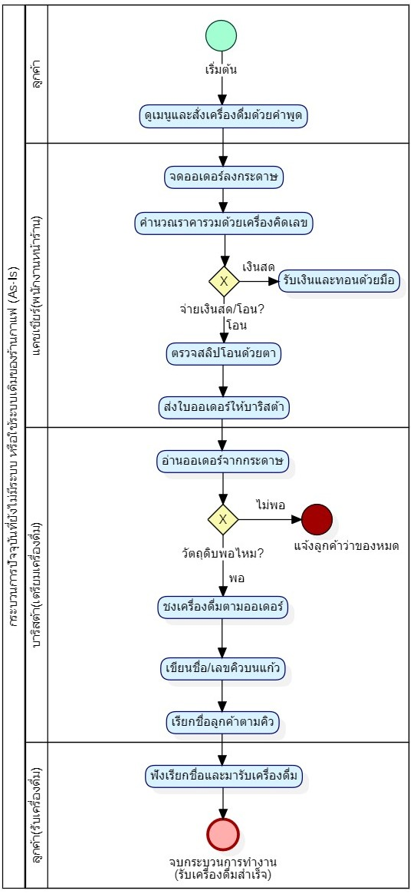
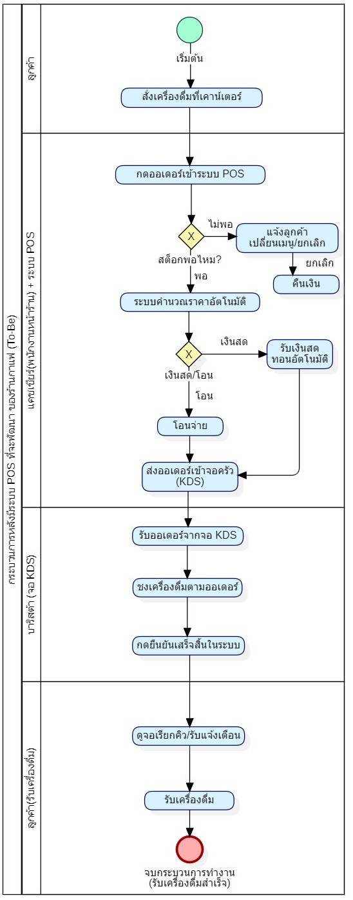

# Workshop สัปดาห์ที่ 2: รายงานความเป็นไปได้ + BPMN

## ระบบ POS ร้านกาแฟ 3-5 สาขา

## ส่วนที่ 1: รายงานความเป็นไปได้ (Feasibility Study)

| หัวข้อ                      | เนื้อหา                                                                                                                                                                                                                                                                                                                                                                                                                  |
| --------------------------- | ------------------------------------------------------------------------------------------------------------------------------------------------------------------------------------------------------------------------------------------------------------------------------------------------------------------------------------------------------------------------------------------------------------------------ |
| **ภาพรวมโครงการ**           | พัฒนาระบบ POS สำหรับร้านกาแฟ 3 สาขา เพื่อรับออเดอร์ คิดเงิน และตัดสต็อกวัตถุดิบแบบอัตโนมัติ เชื่อมข้อมูลทุกสาขาแบบเรียลไทม์ ผู้ใช้หลักคือพนักงานหน้าร้าน บาริสต้า และเจ้าของร้าน                                                                                                                                                                                                                                         |
| **Technical Feasibility**   | ใช้ Node.js/Express + MySQL ทีมมีพื้นฐานปานกลาง ความเสี่ยงหลัก: การซิงค์ข้อมูลสต็อกวัตถุดิบระหว่าง 3-5 สาขาแบบเรียลไทม์ ซึ่งทีมยังไม่มีประสบการณ์ตรง                                                                                                                                                                                                                                                                     |
| **Economic Feasibility**    | One-time cost: ค่าพัฒนาระบบ 30,000 บาท + แท็บเล็ต 3 เครื่อง 19,500 + เครื่องพิมพ์ใบเสร็จ 3 เครื่อง 9,000 และ อุปกรณ์เน็ตเวิร์ก + ติดตั้ง 3 สาขา 7,500 รวมประมาณ 66,000 บาท / Recurring cost: ค่าเช่า server และค่าบำรุงรักษาประมาณ 1,500 บาท/เดือน. ฝั่งผลตอบแทนที่จับต้องได้คือประหยัดเวลาคิดเงิน+ปิดยอดวันละ 30 นาทีขึ้นไปต่อสาขา ลดโอกาสตัดสต็อกผิดและ รับลูกค้าได้มากขึ้น/เร็วขึ้น คาดว่าจะคืนทุนได้ในประมาณ 8 เดือน |
| **Operational Feasibility** | พนักงานรวม 3 สาขา ~15 คน ส่วนใหญ่คุ้นเคยสมาร์ตโฟนอยู่แล้ว คาดว่าฝึกอบรมใช้งานจริงประมาณ 3 ชั่วโมงต่อสาขา ความเสี่ยง: พนักงานบางคนอายุมากอาจต้องการเวลาปรับตัวเพิ่ม เจ้าของร้านสนับสนุนเต็มที่เพราะต้องการเห็นยอดขายรวมทุกสาขาแบบเรียลไทม์                                                                                                                                                                                |
| **Schedule Feasibility**    | ทีมมีเวลา 16 สัปดาห์: สัปดาห์ 1-4 วิเคราะห์และออกแบบ (รวม Feasibility + BPMN + Requirements), สัปดาห์ 5-12 พัฒนา (Backend API, Frontend), สัปดาห์ 13-16 ทดสอบระบบและนำเสนอ                                                                                                                                                                                                                                               |
| **ข้อสรุป**                 | **ควรดำเนินโครงการต่อ** เพราะผลตอบแทนที่ได้ (ประหยัดเวลา ลดของหาย/ตัดสต็อกผิด) คุ้มกับต้นทุนที่ลงไป ทีมก็มีพื้นฐานด้านเทคนิคพอทำได้ทันเวลา ความเสี่ยงหลักๆ น่าจะอยู่ที่พนักงานอายุมากปรับตัวไม่ทัน ซึ่งแก้ได้ด้วยการออกแบบ UI ให้ใช้ง่ายและอบรมเพิ่ม                                                                                                                                                                     |
|                             |

---

## ส่วนที่ 2: BPMN Diagram

### 2.1 As-Is (กระบวนการปัจจุบัน — จดออเดอร์และคิดเงินด้วยมือ)

**ปัญหาของ As-Is:** เสี่ยงจดออเดอร์ผิด, ไม่มีข้อมูลยอดขายรวมแบบเรียลไทม์ระหว่างสาขา, ตัดสต็อกวัตถุดิบด้วยมือทำให้คลาดเคลื่อน, ตรวจสลิปโอนเงินด้วยตาเสี่ยงสลิปปลอม

### 2.2 To-Be (กระบวนการหลังมีระบบ POS)

**ประโยชน์ของ To-Be:** ลดข้อผิดพลาดจากการจดด้วยมือ, ตัดสต็อกและบันทึกยอดขายอัตโนมัติแบบเรียลไทม์ทุกสาขา, ยืนยันการชำระเงิน QR ผ่านระบบโดยตรงลดความเสี่ยงสลิปปลอม ซึ่งตอบโจทย์ Economic Feasibility (ประหยัดเวลาปิดยอด) และ Operational Feasibility (ลดภาระงานพนักงาน)

---

## ส่วนที่ 3: อภิปราย: BPMN แบบ To-Be ช่วยแก้ปัญหาใน Operational และ Economic Feasibility อย่างไร

# 1. การแก้ปัญหาด้าน Operational Feasibility

## 1.1 ลดความผิดพลาดในการรับออเดอร์

- พนักงานบันทึกข้อมูลผ่านระบบ POS
- ระบบตรวจสอบและคำนวณราคาอัตโนมัติ
- มีขั้นตอนให้ลูกค้าตรวจสอบรายการก่อนชำระเงิน

**ผลลัพธ์**

- ลดการสั่งผิดเมนู
- ลดการคิดเงินผิด
- ลดการแก้ไขออเดอร์ภายหลัง

---

## 1.2 ลดเวลาการทำงานของพนักงาน

- ระบบคิดราคาอัตโนมัติ
- ส่งออเดอร์เข้า KDS ทันที

**ผลลัพธ์**

- ขั้นตอนทำงานสั้นลง
- ลูกค้ารอคิวน้อยลง
- รองรับลูกค้าได้มากขึ้น

---

## 1.3 เพิ่มความถูกต้องในการผลิตเครื่องดื่ม

- ระบบส่งข้อมูลเข้า KDS
- บาริสต้ารับข้อมูลจากหน้าจอ
- กดสถานะ "เสร็จ" ในระบบ

**ผลลัพธ์**

- ลดการอ่านลายมือผิด
- ลดการตกหล่นของออเดอร์
- สามารถติดตามสถานะได้

---

## 1.4 เพิ่มการติดตามสถานะ

- แจ้งเตือนเมื่อเครื่องดื่มเสร็จ
- ลูกค้ารับเครื่องดื่มตามคิว

**ผลลัพธ์**

- ลดความสับสน
- ลูกค้าทราบสถานะชัดเจน
- การให้บริการเป็นระบบมากขึ้น

---

# 2. การแก้ปัญหาด้าน Economic Feasibility

## 2.1 ลดต้นทุนแรงงาน

- คิดเงินอัตโนมัติ
- ส่งออเดอร์อัตโนมัติ
- แจ้งสถานะอัตโนมัติ

**ผลลัพธ์**

- พนักงานทำงานได้รวดเร็วขึ้น
- ใช้จำนวนพนักงานน้อยลงในช่วงลูกค้าเยอะ

---

## 2.2 ลดต้นทุนจากความผิดพลาด

มีจุดตรวจสอบก่อนยืนยันออเดอร์จึงช่วยลด

- การทำเครื่องดื่มผิด
- การคืนสินค้า
- การสูญเสียวัตถุดิบ

---

## 2.3 ลดต้นทุนเอกสาร

**ผลลัพธ์**

- ลดการใช้กระดาษ
- ลดค่าใช้จ่ายด้านอุปกรณ์สำนักงาน

---

## 2.4 เพิ่มรายได้จากการให้บริการรวดเร็วขึ้น

- รับออเดอร์เร็ว
- ชำระเงินเร็ว
- ส่งออเดอร์เร็ว
- ผลิตเร็ว
  ทำให้
- รับลูกค้าได้มากขึ้น
- ลดเวลารอคิว
- เพิ่มยอดขายในช่วงเวลาเร่งด่วน

---
