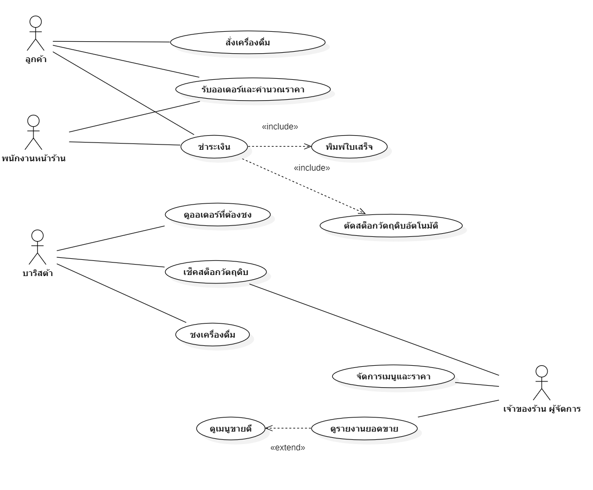

# wk04 – User Stories และ Use Case Diagram (ระบบ POS ร้านกาแฟ)

## 1. Actor

| Actor                 | ใช้ระบบทำอะไร                                                  |
| --------------------- | -------------------------------------------------------------- |
| ลูกค้า                | สั่งเครื่องดื่มและชำระเงินกับพนักงาน (ไม่ได้ใช้หน้าจอ POS เอง) |
| พนักงานหน้าร้าน       | รับออเดอร์ลูกค้า พิมพ์ใบเสร็จ รับชำระเงิน                      |
| บาริสต้า              | ดูออเดอร์ที่ต้องชง เช็คสต็อกวัตถุดิบ                           |
| เจ้าของร้าน/ผู้จัดการ | ดูรายงานยอดขาย จัดการเมนู/ราคา ดูสต็อก ดูเมนูขายดี             |

## 2. Use Case Diagram (Mermaid — ใช้แทนชั่วคราว ก่อนนำไป render ใน StarUML)

หมายเหตุความสัมพันธ์:

- ลูกค้าและพนักงานหน้าร้านมี Association ไปยัง use case เดียวกัน ("รับออเดอร์และคำนวณราคา", "ชำระเงิน") เพราะลูกค้าเป็นผู้ริเริ่ม/ตัดสินใจ ส่วนพนักงานเป็นผู้ปฏิบัติการหน้าจอจริง — ถ้าต้องการความเคร่งครัดตาม UML (actor ต้องกระทำกับระบบโดยตรง) ให้ตัดเส้น Customer ออกและเหลือเฉพาะ Staff
- **Include**: "ชำระเงิน" (base) → "พิมพ์ใบเสร็จ" และ "ตัดสต็อกวัตถุดิบอัตโนมัติ" (included) — เกิดขึ้นทุกครั้งที่ชำระเงินสำเร็จ (FR-04, FR-06) ลูกศรชี้ออกจาก base
- **Extend**: "ดูเมนูขายดี" (extending) → "ดูรายงานยอดขาย" (base) — เป็น optional เฉพาะเมื่อเจ้าของร้านเลือกดูช่วงเวลาสำหรับเมนูขายดี (FR-08 ต่อยอดจาก FR-07) ลูกศรชี้กลับเข้า base
- "เช็คสต็อกวัตถุดิบ" เป็น use case ร่วมของทั้งบาริสต้า (เช็คก่อนชง) และเจ้าของร้าน (ดูภาพรวมเพื่อสั่งซื้อเพิ่ม) — Association 2 เส้นเข้า use case เดียวกัน
- สต็อกวัตถุดิบถูกกำหนดให้ตัดตอน **ชำระเงินสำเร็จ** ไม่ใช่ตอนยืนยันออเดอร์ ตามถ้อยคำ FR-06 ("หลังจากการขายสำเร็จ")

## 3. Use Case Description

### 3.1 รับออเดอร์และคำนวณราคา

**Actor:** พนักงานหน้าร้าน
**Precondition:** ระบบมีรายการเมนูพร้อมราคาและสถานะสต็อกอยู่ในระบบแล้ว

**Main Flow:**

1. พนักงานเลือกรายการเมนูที่ลูกค้าสั่ง
2. ระบบตรวจสอบว่าเมนูที่เลือกมีวัตถุดิบเพียงพอ
3. พนักงานระบุจำนวนของแต่ละรายการ
4. ระบบคำนวณราคารวมของรายการสั่งซื้อ
5. ระบบบันทึกรายการสั่งซื้อ
6. ระบบแสดงยอดรวมเพื่อดำเนินการต่อที่ "ชำระเงิน"

**Alternative Flow:**
3a. พนักงานแก้ไขจำนวน/รายการก่อนยืนยัน → ระบบคำนวณราคารวมใหม่ทุกครั้งที่แก้ไข

**Exception Flow:**
2a. วัตถุดิบของเมนูที่เลือกไม่เพียงพอ → ระบบแจ้งเตือนว่าเมนูหมดชั่วคราว และไม่อนุญาตให้เพิ่มรายการนั้น

**Postcondition:** มีรายการสั่งซื้อที่บันทึกพร้อมยอดรวมถูกต้อง (สำเร็จ) หรือรายการสั่งซื้อยังไม่ถูกบันทึก (ไม่สำเร็จ)

### 3.2 ชำระเงิน

**Actor:** พนักงานหน้าร้าน
**Precondition:** มีรายการสั่งซื้อที่ผ่าน Use Case "รับออเดอร์และคำนวณราคา" แล้ว และทราบยอดรวมที่ต้องชำระ

**Main Flow:**

1. พนักงานเลือกวิธีชำระเงิน — "เงินสด" หรือ "เงินโอน"
2. กรณีเลือก "เงินสด": พนักงานกรอกจำนวนเงินสดที่ลูกค้าจ่ายมา ระบบคำนวณเงินทอนและแสดงผล
   กรณีเลือก "เงินโอน": พนักงานตรวจสอบสลิป/หลักฐานการโอนด้วยตนเอง แล้วกดยืนยันว่าลูกค้าโอนเงินแล้ว (ไม่มีการคำนวณเงินทอน)
3. พนักงานกดยืนยันการชำระเงิน
4. ระบบบันทึกสถานะออเดอร์เป็น "ชำระเงินแล้ว" พร้อมบันทึกวิธีชำระเงินที่ใช้
5. ระบบพิมพ์ใบเสร็จ
6. ระบบตัดสต็อกวัตถุดิบอัตโนมัติ

**Alternative Flow:**
2a. พนักงานกรอกจำนวนเงินสดผิดก่อนยืนยัน → แก้ไขตัวเลขได้ ระบบคำนวณเงินทอนใหม่ทุกครั้งที่แก้ไข ตราบใดที่ยังไม่กดยืนยันในขั้นตอน 3
1a. พนักงานเลือกวิธีชำระเงินผิดก่อนยืนยัน → เปลี่ยนวิธีชำระเงินได้ตราบใดที่ยังไม่กดยืนยันในขั้นตอน 3

**Exception Flow:**
2a. (กรณีเงินสด) จำนวนเงินสดที่กรอกน้อยกว่ายอดที่ต้องชำระ → ระบบแจ้งเตือนว่าจำนวนเงินไม่พอ และไม่อนุญาตให้กดยืนยันในขั้นตอน 3
2b. (กรณีเงินโอน) พนักงานไม่พบหลักฐานการโอนที่ตรงกับยอด → พนักงานไม่กดยืนยัน ออเดอร์คงสถานะรอชำระต่อไป ระบบไม่มีทางตรวจสอบสลิปอัตโนมัติเพราะเป็นการ mock

**Postcondition:** ออเดอร์มีสถานะ "ชำระเงินแล้ว" พร้อมบันทึกวิธีชำระเงิน มีใบเสร็จและสต็อกที่ตัดแล้ว (สำเร็จ) หรือออเดอร์ยังคงสถานะเดิมรอชำระ (ไม่สำเร็จ)

### 3.3 ตัดสต็อกวัตถุดิบอัตโนมัติ

**Actor:** ระบบ (ทำงานอัตโนมัติ ไม่มี actor มนุษย์เป็นผู้เริ่ม — ถูกเรียกจาก Use Case "ชำระเงิน" เท่านั้นผ่านความสัมพันธ์ include)
**Precondition:** ออเดอร์เพิ่งเปลี่ยนสถานะเป็น "ชำระเงินแล้ว" และมีรายการเมนูพร้อมสูตร ที่ระบุปริมาณวัตถุดิบต่อ 1 หน่วยเมนูอยู่ในระบบ

**Main Flow:**

1. ระบบดึงรายการเมนูทั้งหมดในออเดอร์ที่เพิ่งชำระเงินสำเร็จ
2. ระบบคำนวณปริมาณวัตถุดิบที่ต้องใช้ของแต่ละเมนู × จำนวนที่สั่ง
3. ระบบลดจำนวนวัตถุดิบในสต็อกตามที่คำนวณได้
4. ระบบตรวจสอบว่าวัตถุดิบใดต่ำกว่าเกณฑ์ขั้นต่ำ ที่กำหนดหรือไม่ (ขอบเขตแจ้งเตือนสต็อกใกล้หมด)
5. ถ้ามีวัตถุดิบต่ำกว่าเกณฑ์ขั้นต่ำ ระบบตั้งสัญลักษณ์เตือนให้แสดงในหน้าจอ "เช็คสต็อกวัตถุดิบ"

**Alternative Flow:**
ไม่มี (เป็น use case ที่ระบบทำอัตโนมัติทั้งหมด ไม่มีจุดตัดสินใจของผู้ใช้)

**Exception Flow:**
2a. สต็อกวัตถุดิบที่มีอยู่จริงไม่พอสำหรับปริมาณที่ต้องตัด (กรณีข้อมูลสต็อกไม่ตรงกับของจริง) → ระบบตัดสต็อกลงจนติดลบหรือเป็น 0 พร้อมบันทึก log ความผิดปกติ และแจ้งเตือนเจ้าของร้าน/ผู้จัดการให้ตรวจสอบสต็อกจริงในสาขานั้น (ไม่ block การชำระเงินที่สำเร็จไปแล้ว)

**Postcondition:** สต็อกวัตถุดิบทุกรายการที่เกี่ยวข้องถูกปรับปรุงให้ตรงกับออเดอร์ที่ขายไปแล้ว และมีการแจ้งเตือนหากใกล้หมด

### 3.4 ดูรายงานยอดขาย

**Actor:** เจ้าของร้าน/ผู้จัดการ
**Precondition:** มีออเดอร์ที่ชำระเงินสำเร็จอย่างน้อย 1 รายการอยู่ในระบบ

**Main Flow:**

1. เจ้าของร้านเปิดหน้ารายงานยอดขาย
2. เจ้าของร้านเลือกช่วงเวลาที่ต้องการดู (รายวัน/รายเดือน) และเลือกสาขา (หรือดูรวมทุกสาขา)
3. ระบบดึงข้อมูลออเดอร์ที่ชำระเงินสำเร็จในช่วงเวลาและสาขาที่เลือก
4. ระบบคำนวณยอดขายรวม และแสดงผล
5. เจ้าของร้านสามารถกดไปยัง "ดูเมนูขายดี" เพื่อดูอันดับเมนูในช่วงเวลาเดียวกัน

**Alternative Flow:**
2a. เจ้าของร้านเปลี่ยนช่วงเวลาหรือสาขาระหว่างดูรายงาน → ระบบดึงและคำนวณยอดขายใหม่ทุกครั้งที่เปลี่ยนตัวกรอง

**Exception Flow:**
3a. ไม่มีออเดอร์ที่ชำระเงินสำเร็จในช่วงเวลา/สาขาที่เลือก → ระบบแสดงข้อความว่าไม่มีข้อมูลในช่วงเวลานี้ แทนการแสดงยอดขาย 0 บาทเฉยๆ เพื่อไม่ให้สับสนกับกรณีมีออเดอร์แต่ยอดขายเป็น 0 จริง

**Postcondition:** เจ้าของร้านเห็นยอดขายรวมที่ถูกต้องตรงกับออเดอร์จริงในช่วงเวลา/สาขาที่เลือก

## Functional Requirements week3

| รหัส  | Requirement                                                                                 |
| ----- | ------------------------------------------------------------------------------------------- |
| FR-01 | ระบบต้องสามารถบันทึกรายการสั่งซื้อของลูกค้าได้                                              |
| FR-02 | ระบบต้องคำนวณราคารวมของแต่ละรายการสั่งซื้อได้ถูกต้อง                                        |
| FR-03 | ระบบต้องสามารถรับชำระเงินได้ทั้งเงินสดและเงินโอน และแสดงเงินทอนอัตโนมัติเมื่อชำระด้วยเงินสด |
| FR-04 | ระบบต้องสามารถพิมพ์ใบเสร็จหลังการชำระเงินสำเร็จได้                                          |
| FR-05 | ระบบต้องให้เจ้าของร้านเพิ่ม แก้ไข และลบรายการเมนูได้                                        |
| FR-06 | ระบบต้องตัดจำนวนวัตถุดิบในสต็อกอัตโนมัติหลังจากการขายสำเร็จ                                 |
| FR-07 | ระบบต้องสามารถแสดงรายงานยอดขายรายวันและรายเดือนได้                                          |
| FR-08 | ระบบต้องแสดงรายการเมนูขายดีที่สุดตามช่วงเวลาที่ผู้ใช้เลือกได้                               |

## 4. User Stories และ Acceptance Criteria

### US-01 (FR-01, FR-02)

As a พนักงานหน้าร้าน, I want บันทึกรายการสั่งซื้อของลูกค้าและให้ระบบคำนวณราคารวมอัตโนมัติ, So that ลดความผิดพลาดจากการคิดราคาด้วยมือและบริการลูกค้าได้เร็วขึ้น

- Given มีเมนูที่พร้อมขายในระบบ, When พนักงานเลือกเมนูและระบุจำนวน, Then ระบบต้องคำนวณราคารวมและแสดงผลถูกต้องทันที
- Given เมนูที่เลือกมีวัตถุดิบไม่เพียงพอ, When พนักงานพยายามเพิ่มเมนูนั้นลงในรายการสั่งซื้อ, Then ระบบต้องแจ้งเตือนว่าเมนูหมดชั่วคราวและไม่อนุญาตให้เพิ่ม

### US-02 (FR-03)

As a พนักงานหน้าร้าน, I want รับชำระเงินจากลูกค้าได้ทั้งเงินสดและเงินโอน พร้อมคำนวณเงินทอนอัตโนมัติเมื่อจ่ายเงินสด, So that ลดความผิดพลาดในการทอนเงินและรองรับวิธีจ่ายที่ลูกค้านิยมใช้จริง

- Given ยอดชำระที่ต้องจ่ายคือ 85 บาท และลูกค้าเลือกจ่ายเงินสด, When พนักงานกรอกจำนวนเงินสดที่ลูกค้าจ่าย 100 บาท, Then ระบบต้องแสดงเงินทอน 15 บาททันที
- Given ลูกค้าจ่ายเงินสดน้อยกว่ายอดที่ต้องชำระ, When พนักงานกรอกจำนวนเงิน, Then ระบบต้องแจ้งเตือนว่าจำนวนเงินไม่พอและไม่อนุญาตให้ยืนยันการชำระ
- Given ลูกค้าเลือกจ่ายเงินโอน, When พนักงานตรวจสอบสลิปแล้วกดยืนยันว่าโอนเงินแล้ว, Then ระบบต้องบันทึกสถานะออเดอร์เป็น "ชำระเงินแล้ว" พร้อมบันทึกวิธีชำระเงินเป็น "เงินโอน" โดยไม่มีการคำนวณเงินทอน

### US-03 (FR-04)

As a พนักงานหน้าร้าน, I want ให้ระบบพิมพ์ใบเสร็จให้ลูกค้าอัตโนมัติทันทีหลังชำระเงินสำเร็จ, So that ส่งมอบหลักฐานการซื้อให้ลูกค้าได้รวดเร็วโดยไม่ต้องเขียนใบเสร็จด้วยมือ

- Given การชำระเงินสำเร็จ, When ระบบบันทึกสถานะออเดอร์เป็น "ชำระเงินแล้ว", Then ระบบต้องพิมพ์ใบเสร็จที่มีรายการสินค้า ราคารวม และเงินทอนครบถ้วนทันที
- Given เครื่องพิมพ์ใบเสร็จขัดข้อง, When ระบบพยายามพิมพ์ใบเสร็จ, Then ระบบต้องแจ้งเตือนพนักงานและเก็บข้อมูลใบเสร็จไว้เพื่อพิมพ์ซ้ำภายหลัง

### US-03b (ต่อยอดจาก Actor "บาริสต้า" — เสริมนอกเหนือ FR เดิม เพื่อให้ครอบคลุม use case "ดูออเดอร์ที่ต้องชง")

As a บาริสต้า, I want เห็นรายการออเดอร์ที่รอชงเรียงตามลำดับเวลาที่รับออเดอร์, So that ชงเครื่องดื่มได้ทันตามคิวและไม่มีออเดอร์ตกหล่น

- Given มีออเดอร์ที่ชำระเงินแล้วรอชง, When บาริสต้าเปิดหน้าจอออเดอร์ที่ต้องชง, Then ระบบต้องแสดงรายการทั้งหมด เรียงตามเวลาที่รับออเดอร์ก่อน-หลัง
- Given บาริสต้าชงเครื่องดื่มของออเดอร์หนึ่งเสร็จแล้ว, When กดยืนยัน "ชงเสร็จ", Then ออเดอร์นั้นต้องหายไปจากรายการที่ต้องชงทันที

### US-04 (FR-05)

As a เจ้าของร้าน/ผู้จัดการ, I want เพิ่ม แก้ไข และลบรายการเมนูได้ด้วยตนเอง, So that ปรับรายการอาหารและราคาให้ทันสถานการณ์จริงโดยไม่ต้องพึ่งทีมพัฒนา

- Given เจ้าของร้านต้องการเพิ่มเมนูใหม่, When กรอกชื่อเมนู ราคา และยืนยันบันทึก, Then เมนูใหม่ต้องปรากฏในรายการที่พนักงานเลือกได้ทันที
- Given เจ้าของร้านต้องการลบเมนูที่เลิกขาย, When กดลบเมนูนั้นและยืนยัน, Then เมนูนั้นต้องไม่ปรากฏให้พนักงานเลือกได้อีกในการสั่งซื้อครั้งถัดไป

### US-05 (FR-06)

As a เจ้าของร้าน/ผู้จัดการ, I want ให้ระบบตัดจำนวนวัตถุดิบในสต็อกอัตโนมัติหลังการขายสำเร็จ, So that ทราบปริมาณวัตถุดิบคงเหลือที่แม่นยำโดยไม่ต้องนับด้วยมือ

- Given ออเดอร์ชำระเงินสำเร็จและเมนูใช้วัตถุดิบ A 2 หน่วยต่อแก้ว, When ลูกค้าสั่ง 3 แก้ว, Then สต็อกวัตถุดิบ A ต้องลดลง 6 หน่วยทันทีหลังชำระเงินสำเร็จ
- Given การชำระเงินไม่สำเร็จหรือถูกยกเลิก, When ออเดอร์ไม่ได้เปลี่ยนสถานะเป็น "ชำระเงินแล้ว", Then ระบบต้องไม่ตัดสต็อกวัตถุดิบของออเดอร์นั้น

### US-05b (ต่อยอดจาก use case ร่วม "เช็คสต็อกวัตถุดิบ" — เสริมนอกเหนือ FR เดิม)

As a บาริสต้า, I want เห็นสถานะสต็อกวัตถุดิบปัจจุบันของแต่ละรายการ พร้อมสัญลักษณ์เตือนเมื่อใกล้หมด, So that เตรียมแจ้งเจ้าของร้านให้สั่งซื้อเพิ่มก่อนวัตถุดิบหมดจริง

- Given วัตถุดิบ B เหลือต่ำกว่าเกณฑ์ขั้นต่ำ ที่กำหนด (เช่น น้อยกว่า 10 หน่วย), When บาริสต้าเปิดหน้าจอสต็อกวัตถุดิบ, Then ระบบต้องแสดงสัญลักษณ์เตือน "ใกล้หมด" กำกับไว้ที่รายการวัตถุดิบ B
- Given เจ้าของร้านต้องการดูสต็อกทุกสาขา, When เปิดหน้าจอสต็อกวัตถุดิบและเลือกดูภาพรวม, Then ระบบต้องแสดงจำนวนคงเหลือของแต่ละวัตถุดิบแยกตามสาขา

### US-06 (FR-07)

As a เจ้าของร้าน/ผู้จัดการ, I want ดูรายงานยอดขายรายวันและรายเดือน, So that ติดตามผลประกอบการและวางแผนธุรกิจได้

- Given มีออเดอร์ที่ชำระเงินสำเร็จ 10 รายการในวันนี้, When เจ้าของร้านเปิดหน้ารายงานยอดขายรายวัน, Then ระบบต้องแสดงยอดรวมตรงกับผลรวมของ 10 ออเดอร์นั้น
- Given เจ้าของร้านเลือกดูรายงานของเดือนที่ผ่านมา, When กดเลือกช่วงเวลาเป็นรายเดือน, Then ระบบต้องแสดงยอดขายรวมของทุกวันในเดือนนั้นถูกต้อง

### US-07 (FR-08)

As a เจ้าของร้าน/ผู้จัดการ, I want ดูรายการเมนูขายดีที่สุดตามช่วงเวลาที่เลือก, So that ตัดสินใจปรับเมนูหรือโปรโมชันให้ตรงกับพฤติกรรมลูกค้า

- Given มีข้อมูลการขายในช่วง 7 วันที่ผ่านมา, When เจ้าของร้านเลือกช่วงเวลา "7 วันล่าสุด" ในหน้ารายงานยอดขาย, Then ระบบต้องแสดงเมนูขายดี 5 อันดับเรียงจากมากไปน้อย
- Given ยังไม่มีข้อมูลการขายในช่วงเวลาที่เลือก, When เจ้าของร้านเลือกช่วงเวลานั้น, Then ระบบต้องแสดงข้อความว่าไม่มีข้อมูล แทนการแสดงค่าว่างหรือ error

## 5. ตรวจสอบ INVEST

### US-01 — บันทึกออเดอร์และคำนวณราคา (พนักงานหน้าร้าน)

- **Independent** — พัฒนาแยกจาก US-02 (ชำระเงิน) ได้ เพราะเป็นขั้นตอนก่อนหน้า ไม่ต้องรอ flow ชำระเงินเสร็จก่อนจึงจะเริ่มพัฒนาได้
- **Negotiable** — รายละเอียด เช่น จะให้แก้ไขจำนวนได้กี่ครั้งก่อนยืนยัน หรือ UI เลือกเมนูเป็นรายการ/กริด ยังปรับได้ตามทีมตกลง
- **Valuable** — พนักงานคำนวณราคาได้แม่นยำและเร็วขึ้น ลดข้อผิดพลาดจากการคิดเลขด้วยมือหน้าร้าน
- **Estimable** — ประเมินได้ เพราะ scope ชัดเจนคือ CRUD รายการสั่งซื้อ + คำนวณราคารวมจากราคาต่อหน่วยที่มีอยู่แล้ว
- **Small** — จำกัดเฉพาะการเลือกเมนู ระบุจำนวน และคำนวณราคา ไม่รวม flow การชำระเงินซึ่งแยกเป็น US-02
- **Testable** — Acceptance Criteria ตรวจสอบได้ตรงๆ เช่น เพิ่มเมนูแล้วราคารวมต้องอัปเดตทันที

### US-02 — ชำระเงินสด/เงินโอน (พนักงานหน้าร้าน)

- **Independent** — พัฒนาแยกจาก US-01 ได้ ตราบใดที่มี interface รับยอดรวมจาก use case ก่อนหน้าเข้ามา ไม่ต้องรอ UI ของ US-01 เสร็จสมบูรณ์
- **Negotiable** — วิธีแสดงตัวเลือกวิธีชำระเงิน (ปุ่ม 2 ปุ่ม หรือ dropdown) เป็นรายละเอียด UI ที่ทีมปรับได้เอง
- **Valuable** — พนักงานรับเงินและทอนเงินได้ถูกต้อง รองรับวิธีจ่ายที่ลูกค้านิยมใช้จริงทั้งเงินสดและโอน
- **Estimable** — ประเมินได้ เพราะเป็น logic คำนวณเงินทอนแบบง่าย + การบันทึกสถานะออเดอร์ ไม่มีความซับซ้อนซ่อนอยู่ (ไม่เชื่อมต่อ payment gateway จริง)
- **Small** — จำกัดเฉพาะการรับเงินและยืนยันสถานะ ไม่รวมการพิมพ์ใบเสร็จหรือตัดสต็อกซึ่งแยกเป็น include use case ต่างหาก
- **Testable** — เช่น "Given ยอด 85 บาท, When จ่ายเงินสด 100 บาท, Then ต้องแสดงเงินทอน 15 บาท"

### US-03 — พิมพ์ใบเสร็จอัตโนมัติ (พนักงานหน้าร้าน)

- **Independent** — พัฒนาแยกได้ เพราะเป็นการ trigger การพิมพ์จาก event "ชำระเงินสำเร็จ" ไม่ต้องรอ use case อื่นนอกจาก US-02
- **Negotiable** — รูปแบบใบเสร็จ (มีโลโก้ร้าน/ไม่มี, ขนาดกระดาษ) เป็นรายละเอียดที่ปรับได้ภายหลังตามอุปกรณ์พิมพ์จริงที่ร้านมี
- **Valuable** — ลูกค้าได้หลักฐานการซื้อทันที ไม่ต้องเขียนใบเสร็จด้วยมือซึ่งช้าและเสี่ยงผิดพลาด
- **Estimable** — ประเมินได้ เพราะ scope คือ generate ข้อความใบเสร็จจากข้อมูลออเดอร์ที่มีอยู่แล้วแล้วส่งไปที่เครื่องพิมพ์/หน้าจอ
- **Small** — จำกัดเฉพาะการพิมพ์ใบเสร็จ ไม่รวมการจัดการกรณีเครื่องพิมพ์ขัดข้องแบบซับซ้อน (มีแค่ exception flow แจ้งเตือนพื้นฐาน)
- **Testable** — เช่น "Given ชำระเงินสำเร็จ, When ระบบบันทึกสถานะ, Then ต้องพิมพ์ใบเสร็จที่มีรายการ ราคารวม เงินทอนครบ"

### US-03b — ดูออเดอร์ที่ต้องชง (บาริสต้า)

- **Independent** — พัฒนาแยกจาก use case ฝั่งพนักงานหน้าร้านได้ เพราะแค่ต้อง query ออเดอร์ที่ชำระเงินแล้วมาแสดง ไม่ต้องแก้ไขข้อมูลออเดอร์
- **Negotiable** — วิธีอัปเดตหน้าจอ (auto-refresh ทุกกี่วินาที หรือ manual refresh) เป็นรายละเอียดทางเทคนิคที่ทีมเลือกได้
- **Valuable** — บาริสต้าไม่พลาดออเดอร์และชงตามคิวที่ถูกต้อง ลดความสับสนเวลาออเดอร์เยอะ
- **Estimable** — ประเมินได้ เพราะเป็นการ query และเรียงลำดับข้อมูลออเดอร์ที่มีอยู่แล้วตามเวลา ไม่มีการคำนวณซับซ้อน
- **Small** — จำกัดเฉพาะการแสดงและเอาออกจากคิวเมื่อชงเสร็จ ไม่รวมการประเมินเวลาชงหรือจัดคิวลำดับความสำคัญ
- **Testable** — เช่น "Given มี 3 ออเดอร์รอชง, When บาริสต้าเปิดหน้าจอ, Then ต้องเห็นครบ 3 รายการเรียงตามเวลา"

### US-04 — จัดการเมนู/ราคา (เจ้าของร้าน/ผู้จัดการ)

- **Independent** — พัฒนาแยกจาก flow POS ทั้งหมดได้ เพราะเป็นการ CRUD ข้อมูลเมนูที่ฝั่งขายหน้าร้านแค่ "อ่าน" ไปใช้เท่านั้น
- **Negotiable** — ฟิลด์เพิ่มเติมของเมนู เช่น รูปภาพ หรือหมวดหมู่ ยังปรับเพิ่มได้ภายหลังตามที่ทีมตกลง
- **Valuable** — เจ้าของร้านปรับเมนู/ราคาเองได้ทันทีโดยไม่ต้องรอทีมพัฒนาแก้โค้ด ตอบสนองสถานการณ์จริงได้เร็ว
- **Estimable** — ประเมินได้ชัดเจน เพราะเป็น CRUD form มาตรฐานบนตารางเมนูที่มีโครงสร้างชัดเจน
- **Small** — จำกัดเฉพาะเพิ่ม/แก้ไข/ลบเมนู ไม่รวมระบบจัดการรูปภาพหรือหมวดหมู่ที่ซับซ้อนเพิ่มเติม
- **Testable** — เช่น "Given เพิ่มเมนูใหม่และบันทึก, When พนักงานเปิดหน้าขาย, Then ต้องเห็นเมนูใหม่ทันที"

### US-05 — ตัดสต็อกวัตถุดิบอัตโนมัติ (ระบบ)

- **Independent** — พัฒนาเป็น module แยกที่ trigger จาก event "ชำระเงินสำเร็จ" ของ US-02 ได้ ไม่ต้องรอ UI ฝั่งอื่นเสร็จ
- **Negotiable** — วิธีคำนวณปริมาณวัตถุดิบต่อเมนู (เก็บเป็นตาราง recipe หรือ field คงที่) เป็นรายละเอียดการออกแบบฐานข้อมูลที่ทีมเลือกได้
- **Valuable** — เจ้าของร้านทราบปริมาณวัตถุดิบคงเหลือที่แม่นยำ ไม่ต้องนับด้วยมือทุกวัน
- **Estimable** — ประเมินได้ เพราะเป็นการคำนวณและ UPDATE ตัวเลขในตาราง stock ตาม transaction ที่ชัดเจน (เหมาะกับที่กำลังเรียน MySQL transaction ในสัปดาห์ 5)
- **Small** — จำกัดเฉพาะการตัดสต็อกและตั้งค่าสัญลักษณ์เตือน ไม่รวมระบบสั่งซื้อวัตถุดิบเพิ่มอัตโนมัติ
- **Testable** — เช่น "Given สั่ง 3 แก้ว ใช้วัตถุดิบ A 2 หน่วย/แก้ว, When ชำระเงินสำเร็จ, Then สต็อก A ต้องลดลง 6 หน่วย"

### US-05b — เช็คสต็อกวัตถุดิบ (บาริสต้า/เจ้าของร้าน)

- **Independent** — พัฒนาแยกจาก US-05 ได้ เพราะเป็นแค่การ "อ่าน" ตัวเลขสต็อกที่มีอยู่แล้วมาแสดงผลพร้อมเกณฑ์ขั้นต่ำ ไม่ต้องแก้ไขข้อมูล
- **Negotiable** — รูปแบบการเตือน (ไอคอนสีแดง หรือข้อความ) และค่าเกณฑ์ขั้นต่ำที่ตั้งไว้ล่วงหน้าเป็นรายละเอียดที่ปรับได้
- **Valuable** — บาริสต้าและเจ้าของร้านเห็นแนวโน้มวัตถุดิบใกล้หมดล่วงหน้า วางแผนสั่งซื้อได้ทัน ไม่ขาดสต็อกกะทันหัน
- **Estimable** — ประเมินได้ เพราะเป็นการเปรียบเทียบตัวเลขสต็อกกับค่าคงที่ที่กำหนดไว้แล้วแสดงผล ไม่มีความกำกวม
- **Small** — จำกัดเฉพาะการแสดงสถานะและสัญลักษณ์เตือน ไม่รวมระบบสั่งซื้อวัตถุดิบอัตโนมัติ
- **Testable** — เช่น "Given วัตถุดิบ B ต่ำกว่าเกณฑ์ขั้นต่ำ, When เปิดหน้าจอสต็อก, Then ต้องเห็นสัญลักษณ์เตือนกำกับ B"

### US-06 — ดูรายงานยอดขาย (เจ้าของร้าน/ผู้จัดการ)

- **Independent** — พัฒนาแยกได้จากฟังก์ชันฝั่งขายหน้าร้านทั้งหมด เพราะเป็นการอ่านและสรุปข้อมูลออเดอร์ที่เกิดขึ้นแล้วเท่านั้น
- **Negotiable** — รูปแบบการแสดงผล (ตารางหรือกราฟ) และตัวกรองสาขาเป็นรายละเอียดที่ทีมปรับได้ตามที่ตกลง
- **Valuable** — เจ้าของร้านติดตามผลประกอบการและวางแผนธุรกิจได้จากข้อมูลจริง ไม่ต้องรวมยอดเองด้วยมือ
- **Estimable** — ประเมินได้ เพราะเป็นการ query และรวมยอดจากตารางออเดอร์ที่มีโครงสร้างชัดเจนอยู่แล้ว
- **Small** — จำกัดเฉพาะรายงานรายวัน/รายเดือน ไม่รวมการ export ไฟล์หรือวิเคราะห์แนวโน้มระยะยาว
- **Testable** — เช่น "Given มี 10 ออเดอร์สำเร็จวันนี้, When เปิดรายงานรายวัน, Then ยอดรวมต้องตรงกับผลรวม 10 ออเดอร์"

### US-07 — ดูเมนูขายดี (เจ้าของร้าน/ผู้จัดการ)

- **Independent** — พัฒนาต่อยอดจาก US-06 ได้โดยไม่กระทบ flow อื่น เพราะเป็น extend use case ที่ query ข้อมูลชุดเดียวกันแค่จัดกลุ่ม/เรียงอันดับต่าง
- **Negotiable** — จำนวนอันดับที่แสดง (5 หรือ 10 อันดับ) เป็นรายละเอียดที่ปรับได้ตามที่ทีมตกลง
- **Valuable** — เจ้าของร้านตัดสินใจปรับเมนูหรือทำโปรโมชันได้ตรงกับพฤติกรรมลูกค้าจริง
- **Estimable** — ประเมินได้ เพราะเป็นการ query แล้ว GROUP BY/ORDER BY จากข้อมูลออเดอร์ที่มีโครงสร้างชัดเจน
- **Small** — จำกัดเฉพาะการจัดอันดับเมนูขายดีตามช่วงเวลา ไม่รวมการวิเคราะห์แนวโน้มเชิงลึกเพิ่มเติม
- **Testable** — เช่น "Given มีข้อมูล 7 วันล่าสุด, When เลือกช่วงเวลานี้, Then ต้องแสดงเมนูขายดี 5 อันดับเรียงมากไปน้อย"
